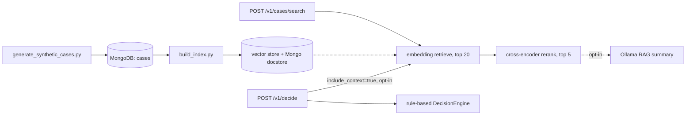

# Insight-OS — Decision Intelligence Platform

Two things, genuinely working, kept honestly separate:

1. **Rule-based operations triage scoring** — deterministic, auditable
   weighted-factor decisions with explanations and guardrails.
2. **A real embedding-search-and-reranking retrieval service** over a
   MongoDB-backed case corpus, with optional local-LLM RAG context
   generation.

This is a research/demo system over **synthetic data**, not a claim about
production traffic or real customer records. Every number in this README
is reproducible by re-running the script referenced next to it.

---

## What's actually in this repo

- A genuine two-stage retrieval pipeline: embedding search (`llama-index`
  + `sentence-transformers` `all-MiniLM-L6-v2`) narrows a corpus, then a
  cross-encoder (`ms-marco-MiniLM-L-6-v2`) reranks the candidates — a real
  measured effect, not decoration (see
  [`docs/architecture.md`](docs/architecture.md#why-retrieve-then-rerank-not-just-embedding-search)).
- **MongoDB** genuinely used: it's the source-of-truth case corpus, the
  decision log (replacing the previous implementation's local append-only
  JSONL file), and LlamaIndex's docstore/index-store backend
  (`llama-index-storage-docstore-mongodb`). What is *not* Mongo-backed —
  the vector data itself, since native `$vectorSearch` requires MongoDB
  Atlas — is documented explicitly, not glossed over.
- Optional **RAG context generation** via a local Ollama LLM
  (`llama3.1:8b`), genuinely retrieval-augmented (the model only sees
  retrieved case text) and manually verified end-to-end — opt-in, not the
  default path, and not exercised by CI. See
  [`docs/architecture.md`](docs/architecture.md#why-rag-generation-is-opt-in-not-the-default-path)
  for exactly why.
- A real, diagnosed performance investigation: the retrieval pipeline was
  profiled stage-by-stage, and the actual bottleneck (`SimpleVectorStore`
  rebuilding its embedding matrix on every query) was isolated and
  documented rather than left as an unexplained slow number. See
  [`docs/architecture.md`](docs/architecture.md#measured-latency-and-a-diagnosed-bottleneck).
- FastAPI service with Pydantic validation, dependency-injected model/index
  loading, structured JSON logging, Prometheus metrics, and OpenTelemetry
  tracing hooks — consistent with the other projects in this portfolio.

## What this repo does **not** claim

- **Not 1M+ records.** The corpus is 50,000 synthetic, templated case
  records (`scripts/generate_synthetic_cases.py`) — a real, tested size,
  not the "1M+" figure referenced elsewhere.
- **Not a specific false-positive-reduction percentage.** No attempt was
  made to reproduce that number.
  `scripts/benchmark_retrieval.py` defines and measures a different,
  explicitly-defined proxy instead — see below.
- **Not sub-200ms p95 latency.** Measured p95 total latency is ~926ms at
  this corpus size, and the dominant cost was profiled and identified (see
  above) rather than hidden.
- **Not a specific "context-management bug" incident.** That's a specific
  narrative claim this repo does not attempt to reconstruct.

---

## Architecture



Full write-up — including the MongoDB/vector-store split, the retrieve-
then-rerank rationale, and the latency investigation — in
[`docs/architecture.md`](docs/architecture.md).

---

## Quickstart

```bash
python3 -m venv .venv
source .venv/bin/activate
pip install -e ".[dev]"
```

### Local MongoDB

```bash
docker run -d --name mongo -p 27017:27017 mongo:7
```

### Seed data and build the retrieval index

```bash
python scripts/generate_synthetic_cases.py --count 50000
python scripts/build_index.py
```

### Run the API

```bash
uvicorn insight_os.api.main:app --reload
```

```bash
curl -X POST http://127.0.0.1:8000/v1/cases/search \
  -H "Content-Type: application/json" \
  -d '{"query": "customer billing discrepancy on invoice", "top_k": 3}'

curl -X POST http://127.0.0.1:8000/v1/decide \
  -H "Content-Type: application/json" \
  -d '{"record_id":"R1","customer_tier":"enterprise","risk_score":0.9,"revenue_impact":100000,"open_issues":6,"sla_hours_remaining":2}'
```

### Docker Compose

```bash
docker compose up -d mongo
docker compose run --rm app python scripts/generate_synthetic_cases.py --count 5000
docker compose run --rm app python scripts/build_index.py
docker compose up -d app
```

(A smaller `--count` is used here deliberately — the full 50k-case index
build takes real time and disk; scale it up as needed. `storage/` is a
regenerable build artifact, not committed to the repo — see
`.gitignore`.)

---

## API

| Method | Path | Purpose |
|---|---|---|
| GET | `/health` | Liveness |
| GET | `/readyz` | Readiness — confirms MongoDB + the retrieval index are loaded |
| POST | `/v1/decide` | Rule-based triage decision; `?include_context=true` adds a RAG summary (requires `INSIGHT_ENABLE_RAG_GENERATION=true`) |
| GET | `/v1/decisions` | Decision log (from MongoDB) |
| POST | `/v1/cases/search` | Embedding search + reranking over the case corpus |
| GET | `/metrics` | Prometheus metrics |
| GET | `/docs` | OpenAPI/Swagger UI |

`POST /v1/cases/search` response includes real, self-reported per-request
`timing_ms` (`vector_retrieve_ms`, `rerank_ms`, `total_ms`) — not a claim
from a benchmark run elsewhere, the actual cost of that specific call.

---

## Retrieval benchmark

```bash
python scripts/benchmark_retrieval.py --sample-size 200
```

From the current committed report
([`eval/results/retrieval_benchmark.md`](eval/results/retrieval_benchmark.md)),
run against the real 50,000-case index:

| Stage | p50 | p95 | p99 |
|---|---|---|---|
| Vector retrieve | 780.9ms | 845.2ms | 1099.2ms |
| Rerank | 40.6ms | 90.8ms | 204.8ms |
| Total | 823.9ms | 925.7ms | 1171.4ms |

**Top-1 issue-type match rate: 100.0%** — defined precisely in the report:
using a case's own summary as the query, does the top reranked result
share that case's `issue_type`? Worth reading honestly, not just citing:
this corpus is templated per `issue_type` with fairly distinct vocabulary,
which makes self-retrieval an easy task — this number demonstrates the
pipeline works end-to-end correctly, not that it would score 100% against
a harder, human-judged relevance benchmark on non-templated text.

---

## Testing

```bash
pytest tests/ -v      # 21 tests: decision engine, real embedding+rerank search, API (mongomock)
ruff check src scripts tests
ruff format --check src scripts tests
mypy src               # strict mode, zero errors
```

Search/API tests use the real embedding model and real cross-encoder
(small, fast) against a tiny in-memory index — not mocks — and `mongomock`
for MongoDB, so they run without a live database. CI additionally runs a
real MongoDB service container and a Docker build + container health-check
smoke test (the container starts, but does not have seeded case data or a
built index in CI — only `/health` is exercised there; see
`.github/workflows/ci.yml`).

---

## Project structure

```text
src/insight_os/
├── decision_engine.py       # rule-based triage scoring (kept from the original implementation)
├── db/mongo.py               # MongoDB client + collections
├── retrieval/
│   ├── embeddings.py          # HuggingFace embedding singleton
│   ├── reranker.py            # cross-encoder reranking
│   ├── index_store.py         # build/load the Mongo-backed + local vector index
│   └── search_service.py      # orchestrates retrieve -> rerank, real per-stage timing
├── rag/generator.py           # optional Ollama-backed RAG context summary
├── api/                       # FastAPI: schemas, dependencies, routes, main
├── config.py                  # pydantic-settings (INSIGHT_ env prefix)
├── logging_config.py          # structlog JSON logging
└── observability.py           # Prometheus + OpenTelemetry wiring
scripts/
├── generate_synthetic_cases.py
├── build_index.py
└── benchmark_retrieval.py
tests/unit/                    # decision engine, search service, API
eval/results/                   # retrieval_benchmark.md
docs/architecture.md             # design rationale, MongoDB/vector-store split, latency investigation
```

---

## Known limitations

- Synthetic data only — see "What this repo does not claim" above.
- Vector search is not Mongo-native (requires Atlas Search, unavailable
  self-hosted); documented in `docs/architecture.md`.
- `SimpleVectorStore` query latency does not scale well past this corpus
  size without swapping in a real ANN backend — diagnosed, not yet fixed.
- RAG generation depends on a locally reachable Ollama server and is not
  exercised by CI.

---

## Author

**Vansh Patel**
M.S. Computer Science (AI & ML), Stevens Institute of Technology

GitHub: https://github.com/vanshpatel9669
LinkedIn: https://linkedin.com/in/vanshpatel1702
