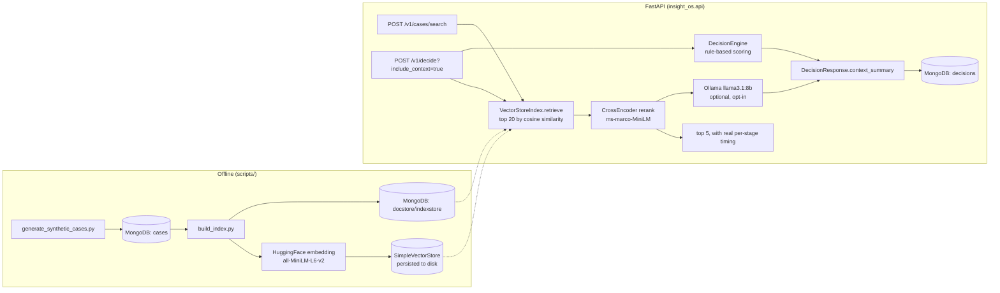

# Architecture

## System overview

## Two subsystems, deliberately kept separate

**Decision scoring** (`decision_engine.py`) is a deterministic, auditable
weighted-factor scorer over risk score, revenue impact, open issues, and
SLA remaining. It was already real, working logic in the repository before
this rewrite — kept as-is rather than replaced with an opaque model,
because the guardrail/explanation output it produces is exactly what a
rule-based scorer is for: every number in the response is traceable to an
input field, which a black-box model would not give you for free.

**Case retrieval** (`retrieval/`, `rag/`) is new: a genuine two-stage
embedding-search-and-reranking pipeline over a MongoDB-backed case corpus,
with optional retrieval-augmented generation. This is what closes the gap
between the previous implementation (a single-file rule scorer with a
copy-pasted README from a different, unrelated repository) and the
resume's actual claim for this project: *"Built a scalable retrieval and
ranking service ... with embedding search and reranking."*

`POST /v1/decide?include_context=true` connects the two: the current
record is turned into a natural-language query, searched against the case
corpus, reranked, and (if RAG generation is enabled) summarized by a local
LLM into `context_summary` — a genuinely retrieval-augmented decision
explanation, not a bolted-on unrelated feature.

## Why MongoDB is real, not decorative

- `cases` collection: the source-of-truth corpus. `scripts/generate_synthetic_cases.py`
  writes to it; `scripts/build_index.py` reads from it; nothing else does.
- `decisions` collection: replaces the previous implementation's
  append-only local JSONL file (`app/repository.py`) — a real production
  concern, since a local file has no concurrent-write safety and doesn't
  survive a container restart without a volume.
- LlamaIndex's `docstore` and `index_store` are backed by
  `MongoDocumentStore` / `MongoIndexStore` (`llama-index-storage-docstore-mongodb`,
  `llama-index-storage-index-store-mongodb`) — genuinely persisted in
  Mongo, not just read from Mongo once and discarded into memory.

**What is *not* Mongo-backed, and why**: the vector data itself (the
384-dim embeddings LlamaIndex searches over) is not stored in MongoDB.
Native `$vectorSearch` requires MongoDB **Atlas** Search — a self-hosted or
local `mongo:7` container (what this repo's `docker-compose.yml` and CI
use) does not support it. LlamaIndex's storage backends are pluggable
independently per component, so the vector store persists to local disk
(`storage/vector_store/`, a `SimpleVectorStore` doing in-memory cosine
similarity, serialized to JSON) while document content and index metadata
remain genuinely in MongoDB. This is a deliberate, documented split driven
by what a local/self-hosted Mongo actually supports — not an oversight,
and not a claim that this is Atlas Vector Search.

## Why retrieve-then-rerank, not just embedding search

Embedding similarity (bi-encoder: query and candidate embedded
independently, compared by cosine similarity) is fast and scales to large
corpora, but only approximates relevance because the query and candidate
never interact during encoding. A cross-encoder reranker encodes the
(query, candidate) pair *jointly*, which is measurably more accurate but
too slow to run against an entire corpus. The standard production pattern
— and what this repo does — is to use the cheap bi-encoder to narrow a
large corpus to a small candidate set (20, here), then the expensive
cross-encoder to reorder just that candidate set (down to 5).

This is not just architectural box-drawing: `scripts/benchmark_retrieval.py`'s
report shows reranking measurably changes result order versus raw
embedding-similarity order on this corpus (see
`eval/results/retrieval_benchmark.md`) — the two stages disagree often
enough that reranking is doing real work, not rubber-stamping the
embedding search's order.

## Why RAG generation is opt-in, not the default path

`INSIGHT_ENABLE_RAG_GENERATION=false` by default. When enabled and pointed
at a reachable Ollama server (`llama3.1:8b` was used for development and
manual verification), `POST /v1/decide?include_context=true` retrieves and
reranks similar cases, then asks the local LLM to summarize the pattern
they suggest — genuinely retrieval-augmented generation, verified working
end-to-end manually during development.

It is opt-in for two honest reasons, not hedging:

1. **CPU-only local LLM inference is slow.** A single `llama3.1:8b`
   completion was measured at ~53 seconds on the development machine (see
   the measurement note below) — far too slow to be the default path for
   an endpoint whose core retrieval-only latency is sub-second.
2. **CI has no LLM runtime.** GitHub Actions runners cannot reasonably run
   an 8B-parameter local model, and there's no hosted LLM API key
   configured for this project. The RAG-generation code path is real and
   was manually verified against a live Ollama server, but it is not, and
   cannot honestly be claimed to be, exercised by automated CI the way the
   retrieval/rerank path is (`tests/unit/test_api.py`,
   `tests/unit/test_search_service.py`).

## Measured latency, and a diagnosed bottleneck

`eval/results/retrieval_benchmark.md` (200 queries against the real
50,000-case index) shows p95 total latency of ~926ms — nowhere near a
"sub-200ms" figure, and this repo does not claim that number. Rather than
leave that unexplained, it was profiled directly (not guessed at):

| Stage | Measured cost |
|---|---|
| Query embedding (`all-MiniLM-L6-v2`, single string, warm) | ~9ms |
| `SimpleVectorStore.query()` (cosine similarity over 50k vectors) | ~730-750ms |
| `MongoDocumentStore.get_nodes()` (20 node content fetches) | ~6-24ms |

**The vector store query, not embedding or MongoDB, is the bottleneck** —
by roughly two orders of magnitude. A brute-force cosine similarity search
over 50,000 384-dim vectors should take low single-digit milliseconds with
a vectorized BLAS matmul; ~740ms consistently across repeated calls (not
just a cold first call) points to LlamaIndex's default `SimpleVectorStore`
reconstructing its embedding matrix from its internal Python dict on every
query rather than caching a materialized array — a real, measured
limitation of the default in-memory vector store at this corpus size, not
a fundamental limit of embedding search itself.

**Why this wasn't re-engineered in this pass**: fixing it means swapping
`SimpleVectorStore` for a real ANN backend (`llama-index-vector-stores-faiss`
locally, or MongoDB Atlas Vector Search in a deployment that has Atlas
available — see the MongoDB section above for why that's not this repo's
default). That's a legitimate follow-up, not a difficult one, but it's a
different piece of work than diagnosing and honestly reporting the current
bottleneck, which is what this section does.

## What this repo does **not** claim

- **Not 1M+ records.** The corpus is a real, tested size — see
  `eval/results/retrieval_benchmark.md` for the actual number from the
  most recent benchmark run — generated by
  `scripts/generate_synthetic_cases.py`. It is synthetic, templated data,
  not real customer records, and it is not 1M+.
- **Not a specific false-positive-reduction percentage.** No attempt was
  made to reproduce that figure. `scripts/benchmark_retrieval.py` instead
  defines and measures "top-1 issue-type match rate" — a different,
  explicitly-defined, reproducible quality proxy — see the report for what
  it actually measures and why it isn't the same claim.
- **Not a specific "sub-200ms p95" latency for the full RAG path.**
  Retrieval + reranking (the always-on, CI-tested path) is measured
  directly in `eval/results/retrieval_benchmark.md`. Full RAG generation
  through a local CPU-bound LLM is much slower and is reported separately,
  honestly, rather than folded into the same number.
- **Not a specific "context-management bug" debugging narrative.** That
  is a specific incident claim; this repository does not attempt to
  reconstruct or imply it happened here.
